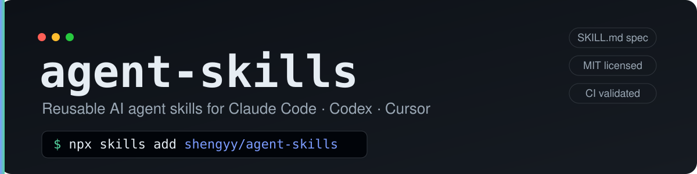

# agent-skills

> Reusable AI agent skills for coding agents like Claude Code and Codex.

**English** | [简体中文](README.zh-CN.md)

[](https://github.com/shengyy/agent-skills/tags)
[](LICENSE)
[](https://github.com/shengyy/agent-skills/actions/workflows/validate-skills.yml)
[](https://skills.sh/)

Built on the common [Agent Skills](https://github.com/anthropics/skills) format (one `SKILL.md` per skill) and installable with a single [`skills`](https://www.npmjs.com/package/skills) CLI command — works across Claude Code, Codex, Cursor, and other agents.

This README covers the project, installation, and document and directory maps. Each skill's `SKILL.md` owns its behavior; [CONTRIBUTING.md](CONTRIBUTING.md) owns contribution and release procedures.

## Install

```bash
# Install every skill (global — available in all projects)
npx skills add shengyy/agent-skills -g --all

# Install just one
npx skills add shengyy/agent-skills -g --skill codex-construction

# List the skills in this repo without installing
npx skills add shengyy/agent-skills -l
```

- `-g` installs to the user-global scope; drop it to install only into the current project's `.claude/skills/`.
- Open a new session after installing. In Claude Code, trigger with `/<skill-name>` or natural language.
- Update: `npx skills update -g` · Uninstall: `npx skills remove -g -s <skill-name>`.

## Available Skills

| Skill | What it does | Requires |
|---|---|---|
| [`codex-construction`](skills/codex-construction/SKILL.md) | Brief-driven delegation: the main agent writes a brief (background, deliverable, focus, quality & resources, style & taste), then lets Codex build via bare `codex exec`, leaving judgment to the models and hard-coding only red lines and field-tested CLI facts — effort on a medium / high / xhigh ladder (higher only when the user names it), background runs with exit notification, acceptance by running the change, and optional independent verification where only run-proven findings count. Codex owns implementation; the main agent owns the brief and acceptance. | `codex` CLI (logged in) |
| [`app-verification`](skills/app-verification/SKILL.md) | Generates and maintains a project-local `verify-<app>` skill so any agent can launch the real app, drive it the way a user does (web/desktop UI, CLI/TUI, service, library), and leave evidence that survives cleanup, backed by a feature map. | None beyond the project's own toolchain |
| [`formal-verification`](skills/formal-verification/SKILL.md) | Picks the promise where a bug costs the most and tests reach the least (concurrency, retries, leases, state machines, parsers), verifies it with the tool the question calls for, shows the check can fail, and leaves a project-local verify skill that keeps the check in step with the code. | The verifier it picks (for example TLA+ tools), installed per project |

### codex-construction

**Prerequisites:**

```bash
npm install -g @openai/codex
codex login
```

For model selection and CLI invocation, see [Launch](skills/codex-construction/SKILL.md#启动);
for reasoning effort, see [Effort tiers](skills/codex-construction/SKILL.md#档位).

## Design philosophy

Current-generation coding models have capability to spare. Pinning down implementation detail
mostly forces them into second-best solutions; what still moves the result is **a clear goal
and a high bar**. So the main agent's effort goes into the brief and acceptance, not process control.

- **Hard-code facts, free up judgment**: the only hard rules are irreversible action
  boundaries and field-tested CLI facts. Brief length, batching, effort, and whether to run
  independent verification are the main agent's call; design, implementation, testing, and
  reversible trade-offs are Codex's. Known biases are handled by asking for a justification,
  not by prohibitions.
- **Write the brief like you'd brief a top engineer**: background and motivation, what the
  deliverable looks like, what matters most, the quality bar plus the resources and latitude
  to reach it, and the style and taste you expect. Add red lines and a fixed run protocol.
- **Accept against the brief**: verify the deliverable yourself, check the focus actually
  landed, read the diff for quality and taste, and review each call Codex made on its own.
  Only irreversible decisions and blockers it can't clear come back as BLOCKED.
- **Verify by running, not by opinion**: a finding counts only when a run proves it — a
  failing command, a repro, output that breaks the intent. Opinions inferred from reading code
  produce a fresh batch every round, and acting on them piles defensive code and abstractions
  on, which is where most over-engineering comes from. So effort goes into making the real app
  drivable ([`app-verification`](skills/app-verification/SKILL.md)) and into exhaustive checks
  where tests can't reach ([`formal-verification`](skills/formal-verification/SKILL.md)),
  not into extra review rounds. This direction, and the two verification skills, are adapted
  from [pstack](https://github.com/cursor/plugins/tree/main/pstack).
- **Progressive disclosure**: each `SKILL.md` carries the path used on every run; content
  needed only in some situations lives in `references/`, linked from the spot where it applies.

The operational rules behind these live in the skill: [Principles](skills/codex-construction/SKILL.md#原则),
[Division of labor](skills/codex-construction/SKILL.md#分工),
[Writing the brief](skills/codex-construction/SKILL.md#写简报),
[Acceptance](skills/codex-construction/SKILL.md#验收), and
[Independent verification](skills/codex-construction/references/verification.md).

## Documentation

| File | Responsibility |
|---|---|
| [README.md](README.md) | English project overview, installation entry point, and document and directory maps. |
| [README.zh-CN.md](README.zh-CN.md) | Synchronized Chinese version of the README. |
| [AGENTS.md](AGENTS.md) | Shared repository conventions and task routing. |
| [CLAUDE.md](CLAUDE.md) | Imports the shared conventions and covers Claude Code's local memory boundary. |
| [codex-construction/SKILL.md](skills/codex-construction/SKILL.md) | Brief structure, delegation, effort tiers, CLI operations, continuation, and acceptance; independent verification and the nohup fallback in `references/`. |
| [app-verification/SKILL.md](skills/app-verification/SKILL.md) | Creating a project-local verify skill that drives the real app; the maintenance pass and a feature-map example in `references/`. |
| [formal-verification/SKILL.md](skills/formal-verification/SKILL.md) | Choosing the target and tool, what a trustworthy check looks like, and generating the verify skill; the maintenance pass in `references/`. |
| [CONTRIBUTING.md](CONTRIBUTING.md) | Adding skills, local installation checks, contributions, and releases. |
| [pull_request_template.md](.github/pull_request_template.md) | PR change description and checklist; contribution procedures live in CONTRIBUTING.md. |
| [CHANGELOG.md](CHANGELOG.md) | Version history and unreleased changes. |
| [VERSION](VERSION) | Current release number. |
| [LICENSE](LICENSE) | MIT license terms. |

## Repository layout

| Directory | Responsibility |
|---|---|
| [Repository root](.) | Repository entry documents and declarations: Agent guidance, READMEs, contribution guide, changelog, version, license, and local artifact ignore rules. |
| [`.github/`](.github/) | GitHub collaboration and automation: the PR template and validation workflow. |
| [`.github/workflows/`](.github/workflows/) | CI definitions; the current workflow runs the repository's skill validation script. |
| [`assets/`](assets/) | README display assets. Assets shipped with a skill belong in that skill's package. |
| [`scripts/`](scripts/) | Repository-level validation (`validate_skills.py` checks skill structure and frontmatter). Scripts shipped with a skill belong in that skill's package. |
| [`skills/`](skills/) | Installable skill packages; their internal layout follows the [repository conventions](AGENTS.md#仓库约定). |
| [`skills/codex-construction/`](skills/codex-construction/) | The codex-construction package. |
| [`skills/app-verification/`](skills/app-verification/) | The app-verification package; `NOTICE.md` keeps the license of the pstack skills it adapts. |
| [`skills/formal-verification/`](skills/formal-verification/) | The formal-verification package; `NOTICE.md` keeps the license of the pstack skills it adapts. |

## Contributing

See [CONTRIBUTING.md](CONTRIBUTING.md). Every skill must pass
`python3 scripts/validate_skills.py`.

## License

[MIT](LICENSE)
